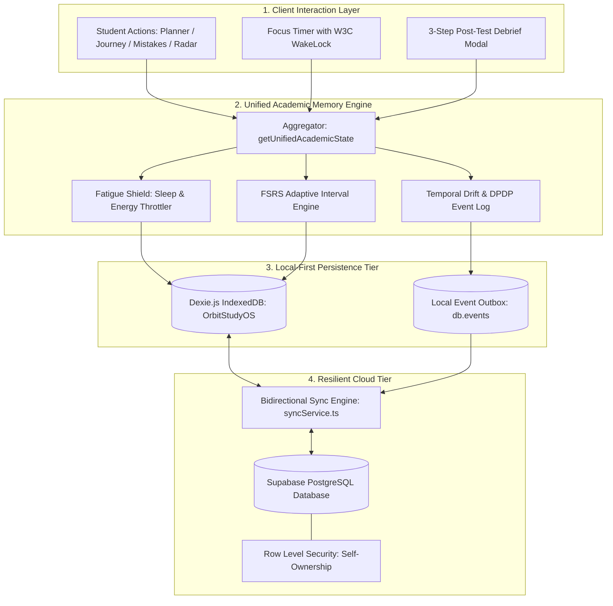
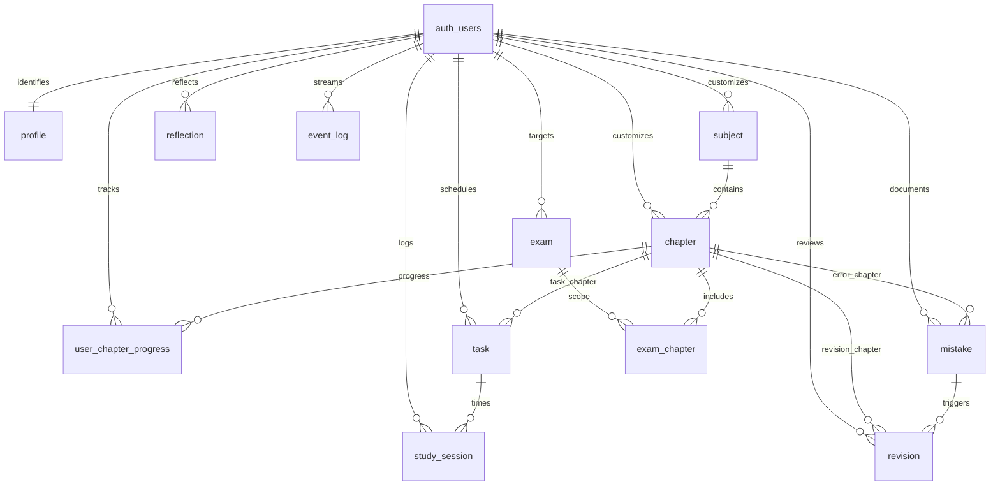

<div align="center">

# Orbit — Adaptive Academic Operating System

[](https://www.typescriptlang.org/)
[](https://nextjs.org/)
[-6842FF?style=for-the-badge)](https://dexie.org/)
[](https://supabase.com/)
[](https://web.dev/progressive-web-apps/)
[](./src/lib/telemetry.ts)
[](LICENSE)

<br />

**A resilient, local-first Academic OS engineered for high-stakes STEM/JEE and College Computer Science & AI scholars.**

*Plan Less. Optimize Learning. Eliminate Cognitive Burnout. Stay in Orbit.*

<br />

[Features](#-core-capabilities--innovations) •
[Architecture](#-system-architecture) •
[Mathematical Models](#-algorithmic--mathematical-specifications) •
[Database Schema](#-relational--offline-data-architecture) •
[Quickstart](#-quickstart--local-development) •
[Documentation](#-official-manuals--specifications)

</div>

---

## Executive Summary

Modern academic preparation is burdened by high cognitive entropy. Scholars preparing for competitive STEM examinations (JEE Advanced, Olympiads, GATE) or mastering Computer Science and Artificial Intelligence juggle fragmented tools: disjointed to-do applications, passive flashcard drills, ad-hoc spreadsheets, uncalibrated timers, and unanalyzed mock exam scorecards. This creates **decision fatigue, memory decay, and severe cognitive burnout**.

**Orbit** replaces this fractured workflow with an **autonomous, closed-loop Academic Operating System**. Engineered with a dual-layer local-first architecture (0ms IndexedDB client latency paired with resilient Supabase PostgreSQL sync), Orbit unifies daily tactical planning, cognitive fatigue throttling, FSRS adaptive spaced repetition, root-cause mistake taxonomies, interactive post-test micro-debriefs, and temporal habit telemetry into a single deterministic feedback loop.

### The Problem vs. Orbit Paradigm

| Dimension | Legacy Student Workflow | Orbit Academic Operating System |
| :--- | :--- | :--- |
| **Tactical Execution** | Static to-do lists causing planning debt | **Zero-Debt Slot Cockpit:** Morning, Afternoon, Evening sessions calibrated to circadian capacity |
| **Cognitive Fatigue** | Ignored until complete burnout occurs | **Proactive Fatigue Shield:** Automatically scales load when sleep is $<6\text{h}$ or energy is depleted |
| **Long-Term Memory** | Passive re-reading or isolated flashcard apps | **Closed-Loop FSRS Engine:** Dynamically compresses review intervals for error-prone chapters |
| **Error Diagnosis** | Unorganized notebooks or forgotten test sheets | **5-Point Cognitive Error Book:** Classifies slips (conceptual, calculation, careless, application, time) |
| **Exam Diagnostics** | Score-only record keeping with no reflection | **3-Step Micro-Debrief Engine:** Dissects paper difficulty, fumble factors, and syllabus leakage |
| **Latency & Offline** | Blank screens or failed writes on network drops | **Dual-Layer Local-First:** 0ms IndexedDB reads/writes with idempotent cloud reconciliation |
| **Focus Fidelity** | Timers throttle and freeze in background tabs | **Drift-Proof Engine:** Precision timestamp deltas ($\Delta t$) + W3C Screen WakeLock API |

---

## 📚 Official Manuals & Specifications

Comprehensive documentation and engineering audit artifacts available in this repository:

* 📘 **[Master User Guide (`orbit_guide.md`)](./orbit_guide.md)** — Comprehensive tab-by-tab operational walkthrough, feature specifications, and student workflows.
* 📄 **[Master Executive Guide PDF (`orbit_guide.pdf`)](./orbit_guide.pdf)** — Publication-grade A4 manual for scholars and institutions.
* 🏛 **[Architectural Audit & Roadmap (`orbit_v2_architectural_audit.md`)](./orbit_v2_architectural_audit.md)** — Architectural audit, system guarantees, and technical design decisions.
* 🤖 **[AI Architecture Blueprint (`scripts/ai_architecture_document.html`)](./scripts/ai_architecture_document.html)** — Detailed design of future LLM reasoning integrations.

---

## 🏛 System Architecture

Orbit is built upon a **Dual-Layer Local-First Architecture**. All client interactions read from and mutate an IndexedDB store (`OrbitStudyOS` via Dexie.js), delivering instant 0ms response times. A non-blocking background synchronization engine reconciles state bidirectionally with Supabase PostgreSQL, enforcing strict Row Level Security (RLS) and schema fallbacks.

```
                                  ┌───────────────────────────────────────────────┐
                                  │            USER / CLIENT SURFACE              │
                                  │      Next.js 14 (App Router) + PWA UI         │
                                  └───────────────────────┬───────────────────────┘
                                                          │
                                                          ▼
        ┌───────────────────────────────────────────────────────────────────────────────────────────────────┐
        │                                 UNIFIED ACADEMIC MEMORY ENGINE                                    │
        │                                   (src/lib/academicState.ts)                                      │
        ├──────────────────────────┬────────────────────────────┬─────────────────────────────┬─────────────┤
        │                          │                            │                             │             │
        ▼                          ▼                            ▼                             ▼             ▼
┌───────────────┐        ┌───────────────────┐        ┌───────────────────┐        ┌──────────────────┐ ┌───────────────┐
│ FATIGUE SHIELD│        │  FSRS RETENTION   │        │  ERROR TAXONOMY   │        │POST-TEST DEBRIEF │ │TEMPORAL HABIT │
│  & CAPACITY   │        │      ENGINE       │        │ & AUTO-REVISION   │        │& EXAM ANALYTICS  │ │   TELEMETRY   │
│ (Sleep/Energy)│        │  (Adaptive SM-2)  │        │ (Root-Cause Tag)  │        │(Single & Multi)  │ │ (Slot Drift)  │
└───────┬───────┘        └─────────┬─────────┘        └─────────┬─────────┘        └────────┬─────────┘ └───────┬───────┘
        │                          │                            │                             │                 │
        └──────────────────────────┴────────────────────────────┼─────────────────────────────┴─────────────────┘
                                                                │
                                                                ▼
                                  ┌───────────────────────────────────────────────┐
                                  │            DUAL PERSISTENCE LAYER             │
                                  ├───────────────────────────────┬───────────────┤
                                  │   LOCAL-FIRST (0ms Latency)   │  CLOUD SYNC   │
                                  │       Dexie / IndexedDB       │   Supabase    │
                                  │       ('OrbitStudyOS')        │  (PostgreSQL) │
                                  └───────────────────────────────┴───────────────┘
```

### End-to-End Reactive Data Flow



---

## ⚡ Core Capabilities & Innovations

### 1. Unified Academic Memory Engine
*File: [`src/lib/academicState.ts`](./src/lib/academicState.ts)*
* Consolidates live student velocity, active backlog volume, mistake distributions, syllabus confidence ratings, target exam countdowns, and energy logs into a single reactive snapshot (`UnifiedStudentState`).
* Evaluates real-time priority scores for all curriculum chapters using an ROI-maximizing formula without blocking UI rendering.
* Provides the deterministic context contract (`buildAiMentorContext`) consumed by analytical and AI mentoring layers.

### 2. Interactive Post-Test Micro-Debrief Engine
*Files: [`src/components/TestDebriefModal.tsx`](./src/components/TestDebriefModal.tsx), [`src/api/testAttempts.ts`](./src/api/testAttempts.ts)*
* **3-Step Micro-Debrief:** Triggers automatically upon checking off a practice test task or clicking the debrief action on any exam card.
* **Single-Subject vs. Multi-Subject Adaptability:** Automatically scales between single-topic coaching quizzes and composite multi-subject exams (e.g. JEE Main, Advanced, GATE).
* **Deep Diagnostic Categorization:** Captures perceived paper difficulty (*Easy, Balanced, Crushing*), fumble factors (*Concept blindspot, Time panic, Calculation slips, In control*), and relative peer difficulty.
* **Closed-Loop Error Ingestion:** Instantly identifies leaked syllabus chapters and provides 1-click mistake enrollment into the Spaced Revision queue.
* **Friction-Free Reflection Field:** Dedicated `student_notes` area for qualitative reflection.

### 3. Cognitive Capacity & Fatigue Shield
*Files: [`src/lib/planningEngine.ts`](./src/lib/planningEngine.ts), [`src/components/CalibratePlanModal.tsx`](./src/components/CalibratePlanModal.tsx)*
* Monitors sleep duration (last night & 7-day rolling average) alongside subjective energy ratings ($1$ to $5$).
* When sleep is $< 6.0\text{ h}$ or energy score is $\le 2/5$:
  * **Dynamic Workload Capping:** Caps total planned study target to $\le 4.0\text{ h}$ (or $3.2\text{ h}$ if coaching sessions overran).
  * **Cognitive Strain Filtering:** Automatically deprioritizes multi-hour problem sets and shifts focus to low-friction active recall and summary review.
  * **Circadian Reallocation:** Reallocates high-friction tasks to optimal analytical chronotype slots.

### 4. FSRS Adaptive Spaced Repetition Engine
*Files: [`src/lib/spacedRepetition.ts`](./src/lib/spacedRepetition.ts), [`src/api/revisions.ts`](./src/api/revisions.ts)*
* Inspired by the Free Spaced Repetition Scheduler (FSRS) and SuperMemo SM-2 models.
* Evaluates exponential memory decay curves $R(t) = \exp(-t / S)$ based on interval stability $S$.
* **Error Backlog Friction:** If a chapter has high unaddressed mistake density, interval progression is dampened by up to $35\%$ to prevent memory collapse before high-stakes exams.
* **In-Place Active Recall Chamber:** Embedded 3-grade assessment (`Again`, `Hard`, `Good`) directly on the daily Planner desk, enabling complete session reviews in under 3 minutes.

### 5. Multi-Signal Universal Streak Engine
*Files: [`src/api/gamification.ts`](./src/api/gamification.ts), [`src/components/OrbitDayRing.tsx`](./src/components/OrbitDayRing.tsx)*
* **Dual-Timestamp Continuity:** Evaluates both `scheduled_date` and `completed_at` timestamps in daily completion sets. Consecutive study streaks (4-day, 10-day, 30-day+) never collapse due to batch completions or timezone crossings.
* **Holistic Activity Recognition:** Spaced repetition reviews and mock test debriefs automatically count toward daily streak continuity and XP accumulation.
* **Dynamic Daily Orbit Ring:** SVG progress ring calculates completion percentage and awards bonus streak shields upon reaching $100\%$.

### 6. Closed-Loop Mistake Vault & Cognitive Error Taxonomy
*Files: [`src/api/mistakes.ts`](./src/api/mistakes.ts), [`src/components/MistakeCard.tsx`](./src/components/MistakeCard.tsx)*
* Enforces root-cause diagnostics across 5 core cognitive classifications:
  * **`Conceptual`** — Theory gap requiring core theorem derivation and lecture re-reading.
  * **`Calculation`** — Arithmetic or algebraic sign slip requiring scratchwork discipline.
  * **`Careless`** — Misread question prompt or missed negative constraint.
  * **`Application`** — Failed to synthesize multi-concept relationships under unfamiliar contexts.
  * **`Time Pressure`** — Time panic during countdown clock requiring timed sprint drills.
* **Automated Spaced Revision Enrollment:** Submitting an error automatically provisions the parent chapter into the FSRS active recall queue.

### 7. Progressive Subject-First Exam Planner & Radar
*Files: [`src/components/AddExamModal.tsx`](./src/components/AddExamModal.tsx), [`src/components/EditExamModal.tsx`](./src/components/EditExamModal.tsx)*
* **Progressive Disclosure:** Test title input $\rightarrow$ clickable subject badge selection $\rightarrow$ tabbed syllabus view restricted strictly to chosen subjects.
* Eliminates dropdown clutter and prevents accidental cross-subject or cross-track syllabus mismatches on exams.
* Bidirectional sync between local Dexie records and Supabase `exam` / `exam_chapter` join tables.

### 8. Strict Single-Track Curricular Isolation
*Files: [`src/app/journey/page.tsx`](./src/app/journey/page.tsx), [`src/lib/curriculumData.ts`](./src/lib/curriculumData.ts)*
* Academic specialization is selected during signup onboarding and permanently locked inside the application:
  * **STEM & Olympiad Track (`jee_nsep`):** Physics, Chemistry, and Mathematics structured to JEE Main, Advanced, and NSEP depth.
  * **College CS & AI Track (`college_cs_aiml`):** Data Structures & Algorithms, Machine Learning & Deep Learning, Web Systems, and Core Computer Science (OS, DBMS, Networks).
* Built-in auto-recovery engine detects subject mutations and restores correct curricular isolation if accidental state drift occurs.

### 9. Behavioral Telemetry & DPDP Compliance
*Files: [`src/lib/telemetry.ts`](./src/lib/telemetry.ts), [`src/api/events.ts`](./src/api/events.ts), [`src/lib/habitEngine.ts`](./src/lib/habitEngine.ts)*
* Local-first outbox pattern in Dexie (`db.events`) with opportunistic background cloud flush to Supabase `event_log`.
* Captures rich behavioral metrics: slot drift (morning $\rightarrow$ night execution shifts), calendar date drift, advance planning ratio, and time estimation ratios.
* Fully compliant with the **India Digital Personal Data Protection (DPDP) Act**: self-contained guest mode, zero third-party telemetry, and zero unconsented data egress.

### 10. Drift-Proof Focus Engine & Screen WakeLock
*File: [`src/components/FocusTimerModal.tsx`](./src/components/FocusTimerModal.tsx)*
* **Timestamp-Delta Calculation:** Replaces setInterval ticks with real system clock deltas ($\Delta t = \text{Date.now()} - t_{\text{start}}$), immune to background tab throttling on iOS and Android.
* **Page Visibility API:** Instantly reconciles elapsed seconds the moment the user returns to the tab.
* **W3C Screen WakeLock API:** Keeps the display awake during deep focus blocks and automatically releases upon pause or session completion.

### 11. Scheduled Academic Notifications & Web Audio Chime
*Files: [`src/lib/notificationService.ts`](./src/lib/notificationService.ts), [`src/lib/orbitSound.ts`](./src/lib/orbitSound.ts)*
* Intelligent study rhythm notifications dispatched via Service Worker / Web Notification API:
  * **07:30 AM** — Daily Mission Pulse (prompts student to review their mission deck).
  * **09:00 AM** — Deep Work Kick-Off (initiates morning analytical session).
  * **10:00 PM** — Evening Reflection & Fatigue Check-In.
* Synthesizes Orbit's signature dual-tone audio chime using the Web Audio API without requiring external audio assets.

### 12. Non-Destructive Bidirectional Sync & Data Portability
*Files: [`src/lib/syncService.ts`](./src/lib/syncService.ts), [`src/lib/uuid.ts`](./src/lib/uuid.ts)*
* RFC 4122 v4 UUID compliance across all client and cloud records.
* Non-destructive reconciliation: background sync never purges local tasks from IndexedDB if the remote network is sluggish or unresponsive.
* Full encrypted JSON snapshot export and restore (`exportOrbitBackupJSON`, `importOrbitBackupJSON`).

---

## 🔬 Algorithmic & Mathematical Specifications

### 1. Expected Return on Investment (ROI) Planning Score
The planning engine calculates the dynamic priority score $\mathcal{P}_c$ for each chapter $c$ to maximize expected score return per unit study time:

$$\mathcal{P}_c = \Big(\underbrace{2.0 \cdot \ln(1 + \mathcal{M}_{\text{unresolved}}) + 1.5 \cdot \mathcal{M}_{\text{conceptual}} + 1.0 \cdot \mathcal{M}_{\text{hard}}}_{\text{Mistake Penalty Matrix}} + \underbrace{2.2 \cdot \frac{100 - \mathcal{C}_c}{100}}_{\text{Confidence Gap}} + \underbrace{\beta_{\text{revision}}}_{\text{Spaced Urgency}}\Big) \times \mathcal{T}_{\text{tier}} \times \mathcal{U}_{\text{exam}}$$

Where:
* $\mathcal{M}_{\text{unresolved}}$, $\mathcal{M}_{\text{conceptual}}$, $\mathcal{M}_{\text{hard}}$ represent unresolved, conceptual, and hard error counts logged in chapter $c$.
* $\mathcal{C}_c \in [0, 100]$ represents current mastery confidence.
* $\beta_{\text{revision}} = 3.5$ if spaced revision is currently due according to FSRS, else $0$.
* Curriculum weightage multiplier $\mathcal{T}_{\text{tier}}$:
  $$\mathcal{T}_{\text{tier}} = \begin{cases} 1.40 & \text{Tier 1 (High Weight / High Frequency)} \\ 1.10 & \text{Tier 2 (Core Curriculum)} \\ 0.85 & \text{Tier 3 (Ancillary Topic)} \end{cases}$$
* Exam proximity multiplier $\mathcal{U}_{\text{exam}}$:
  $$\mathcal{U}_{\text{exam}} = \begin{cases} \max\left(1.80, \frac{15}{\max(1, \Delta_{\text{days}})}\right) & \text{if chapter is explicitly targeted in upcoming exam} \\ 0.50 & \text{if upcoming exam targets other specific chapters} \\ 1.00 & \text{baseline} \end{cases}$$

### 2. Cognitive Capacity & Fatigue Throttling Model
Available daily study hours $\mathcal{H}_{\text{recommended}}$ are dynamically computed based on reported sleep $\mathcal{S}$ and energy rating $\mathcal{E} \in \{1, \dots, 5\}$:

$$\eta = \begin{cases} 0.60 & \text{if } \mathcal{E} = 1 \lor \mathcal{S} < 5.0\text{ h} \\ 0.75 & \text{if } \mathcal{E} = 2 \lor \mathcal{S} < 6.0\text{ h} \\ 0.88 & \text{if } \mathcal{E} = 3 \\ 1.00 & \text{otherwise} \end{cases}$$

$$\mathcal{H}_{\text{recommended}} = \min\Big(\text{round}(\mathcal{H}_{\text{base}} \times \eta), \quad \mathcal{H}_{\text{coaching\_cap}}\Big)$$

Where $\mathcal{H}_{\text{base}} = 4.5\text{ h}$ for STEM/Olympiad and $4.0\text{ h}$ for College CS; $\mathcal{H}_{\text{coaching\_cap}} = 3.2\text{ h}$ if coaching sessions have overran $\ge 2$ times recently.

### 3. FSRS Adaptive Memory Retention & Interval Growth
Retention probability $R(t)$ after $t$ elapsed days given memory stability $S = 1.2 \times \mathcal{I}_{\text{days}}$:

$$R(t) = \exp\left(-\frac{t}{S}\right)$$

Next review interval $\mathcal{I}_{\text{next}}$ is computed adaptively:

$$\mathcal{I}_{\text{next}} = \begin{cases} 
1 \text{ or } 2 & \text{if grade} = \text{failed} \\
\min\left(90, \max(\mathcal{I} + 1, \text{round}(\mathcal{I} \times \mu \times \Lambda_{\text{mistakes}}))\right) & \text{if successful}
\end{cases}$$

Where the grade multiplier $\mu \in \{2.6 \text{ (Easy)}, 2.0 \text{ (Good)}, 1.35 \text{ (Hard)}\}$, and mistake backlog friction $\Lambda_{\text{mistakes}}$ dampens interval acceleration:

$$\Lambda_{\text{mistakes}} = \begin{cases} 0.65 & \text{if unresolved mistakes } \ge 3 \\ 0.82 & \text{if unresolved mistakes } > 0 \\ 1.00 & \text{clean chapter} \end{cases}$$

### 4. Multi-Signal Universal Streak Invariant
Let $\mathcal{T}$ be the set of all tasks, $\mathcal{R}$ the set of spaced revisions, and $\mathcal{M}$ the set of mock test attempts. The daily activity indicator $\mathcal{A}(d)$ for calendar date $d$ is defined as:

$$\mathcal{A}(d) = \mathbb{I}\Big[\Big(\exists t \in \mathcal{T}_{\text{completed}} : \text{date}(t.\text{scheduled}) = d \lor \text{date}(t.\text{completed}) = d\Big) \lor \Big(\exists r \in \mathcal{R} : \text{date}(r.\text{reviewed}) = d\Big) \lor \Big(\exists m \in \mathcal{M} : \text{date}(m.\text{attempted}) = d\Big)\Big]$$

A continuous streak of length $K$ days ending on date $d_0$ requires $\prod_{i=0}^{K-1} \mathcal{A}(d_0 - i) = 1$.

---

## 🗄 Relational & Offline Data Architecture

### Supabase PostgreSQL Production Schema

All tables are secured with **Row Level Security (RLS)** using self-ownership predicates (`user_id = auth.uid()`). Foreign keys use cascade rules, and query paths are optimized with B-Tree and GIN indexes.



#### Core Database Tables

| Table Name | Primary Key | Key Columns & Constraints | Purpose |
| :--- | :--- | :--- | :--- |
| **`profile`** | `id (uuid, FK auth.users)` | `display_name`, `created_at` | User account metadata and display name |
| **`subject`** | `id (uuid)` | `user_id`, `name`, `track (jee_nsep \| college_cs_aiml \| all)` | Curriculum subjects and custom academic tracks |
| **`chapter`** | `id (uuid)` | `subject_id (FK)`, `user_id`, `name` | Syllabus chapters and custom learning units |
| **`user_chapter_progress`** | `id (uuid)` | `user_id (FK)`, `chapter_id (FK)`, `confidence_score (0-100)`, `status` | Chapter confidence, status lifecycle, and notes |
| **`task`** | `id (uuid)` | `user_id (FK)`, `chapter_id (FK)`, `scheduled_date`, `time_slot`, `status`, `slot_drift` | Daily tactical missions and slot execution logs |
| **`study_session`** | `id (uuid)` | `user_id (FK)`, `task_id (FK)`, `start_time`, `end_time`, `paused_seconds` | Pomodoro focus sessions and duration analytics |
| **`mistake`** | `id (uuid)` | `user_id (FK)`, `chapter_id (FK)`, `mistake_type`, `difficulty`, `resolved` | 5-point cognitive error log with resolution status |
| **`revision`** | `id (uuid)` | `user_id (FK)`, `chapter_id (FK)`, `due_date`, `interval_days`, `review_count` | FSRS spaced repetition queue and interval history |
| **`reflection`** | `id (uuid)` | `user_id (FK)`, `day`, `sleep_hours`, `energy_rating (1-5)`, `wins`, `blockers` | Evening cognitive check-ins and fatigue data |
| **`event_log`** | `id (uuid)` | `user_id (FK)`, `event_type`, `metadata (jsonb)` | Append-only behavioral event stream for telemetry |
| **`exam`** | `id (uuid)` | `user_id (FK)`, `name`, `exam_type`, `exam_date` | High-stakes exam countdowns and test milestones |
| **`exam_chapter`** | `(exam_id, chapter_id)` | Composite Primary Key | Many-to-many join table for exam syllabus scope |

### IndexedDB Local Schema (`OrbitStudyOS`)

Client-side persistence is powered by **Dexie.js** with full schema versioning:

```typescript
// src/lib/db.ts
this.version(1).stores({
  tasks: 'id, user_id, scheduled_date, time_slot, status, chapter_id',
  mistakes: 'id, user_id, chapter_id, resolved, created_at',
  revisions: 'id, user_id, chapter_id, due_date',
  exams: 'id, user_id, exam_date, exam_type',
  progress: '++id, [user_id+chapter_id], chapter_id, status',
  reflections: 'id, [user_id+day], user_id, day',
  events: 'id, user_id, event_type, created_at',
});
this.version(2).stores({
  events: 'id, user_id, event_type, sync_status, created_at',
});
this.version(3).stores({
  test_attempts: 'id, user_id, attempt_date, exam_id, paper_difficulty, fumble_factor',
});
```

---

## 📁 Repository Structure

```
orbit-web-v2/
├── .env.example                       # Reference environment variables
├── middleware.ts                      # Supabase SSR auth guard & route protection
├── next.config.js                     # Next.js configuration & PWA headers
├── package.json                       # Dependencies & build scripts
├── tsconfig.json                      # Strict TypeScript compiler options
├── tailwind.config.ts                 # Modern dark-mode palette & design tokens
├── orbit_guide.md                     # Official 5-page student user manual
├── orbit_guide.pdf                    # Publication-grade A4 user manual
├── orbit_v2_architectural_audit.md    # Architectural audit & roadmap
├── scripts/
│   ├── ai_architecture_document.html  # AI mentor architecture blueprint
│   └── generate_ai_architecture_pdf.py# Automated PDF manual generator
├── supabase/
│   └── complete_orbit_database.sql    # Idempotent master database schema & seed
├── public/                            # PWA manifest, service worker & icons
└── src/
    ├── api/                           # Dual-layer persistence drivers (Dexie + Supabase)
    │   ├── chapters.ts                # Chapter metadata & progress mutators
    │   ├── events.ts                  # Offline-first behavioral telemetry outbox
    │   ├── exams.ts                   # Exam milestone CRUD & sample isolation
    │   ├── gamification.ts            # Multi-signal streak engine & XP leveling
    │   ├── journey.ts                 # Syllabus hierarchy & dossier queries
    │   ├── mistakes.ts                # Error logging & auto-spaced repetition trigger
    │   ├── profile.ts                 # Profile preferences & energy settings
    │   ├── reflection.ts              # Daily reflection & fatigue check-in
    │   ├── revisions.ts               # Spaced repetition queues & recall assessment
    │   ├── study_sessions.ts          # Focus timer persistence
    │   ├── tasks.ts                   # Task lifecycle, slot execution & fallbacks
    │   └── testAttempts.ts            # Post-test debrief recording & mistake linkage
    ├── app/                           # Next.js 14 App Router surfaces
    │   ├── journey/                   # Interactive syllabus tree & chapter dossiers
    │   │   └── [chapterId]/           # Deep academic dossier (mistakes, FSRS, notes)
    │   ├── login/                     # Supabase Auth with permanent track onboarding
    │   ├── mistakes/                  # Mistake Vault with 5-point cognitive taxonomy
    │   ├── planner/                   # Tactical cockpit, Orbit Day Ring & recall chamber
    │   ├── profile/                   # Energy, sleep, account settings & JSON backup
    │   ├── week/                      # 7-day tactical load, exams & test debriefs
    │   ├── globals.css                # Global styles, glassmorphism & font tokens
    │   └── layout.tsx                 # Root layout, PWA tags & navigation frame
    ├── components/                    # High-craft design system & desk widgets
    │   ├── AddExamModal.tsx           # Subject-first progressive exam creation
    │   ├── EditExamModal.tsx          # Tabbed syllabus exam editor
    │   ├── TestDebriefModal.tsx       # 3-step post-test micro-debrief modal
    │   ├── FocusTimerModal.tsx        # Drift-proof timer with Screen WakeLock API
    │   ├── CalibratePlanModal.tsx     # Fatigue shield & capacity auto-calibrator
    │   ├── OrbitDayRing.tsx           # SVG completion ring with streak multiplier
    │   ├── SwipeableTaskRow.tsx       # Smooth task item with gesture & undo actions
    │   ├── SlotAccordion.tsx          # Morning / Afternoon / Evening session decks
    │   ├── StreakAndLevel.tsx         # Streak badge and XP level progression
    │   ├── MissedTasksVault.tsx       # Zero-guilt backlog rescue chamber
    │   └── ...                        # Additional modals and widgets
    ├── lib/                           # Core intelligence engines & infrastructure
    │   ├── academicState.ts           # Unified Academic Memory State Aggregator
    │   ├── curriculumData.ts          # Curriculum taxonomy & ID resolvers
    │   ├── db.ts                      # Dexie.js IndexedDB schema ('OrbitStudyOS')
    │   ├── habitEngine.ts             # Chronotype & slot drift behavioral analysis
    │   ├── notificationService.ts     # Scheduled academic notifications & service worker
    │   ├── orbitSound.ts              # Web Audio API procedural chime synthesizer
    │   ├── planningEngine.ts          # ROI-maximizing task allocation & fatigue shield
    │   ├── spacedRepetition.ts        # FSRS / SM-2 memory retention engine
    │   ├── syncService.ts             # Non-destructive bidirectional cloud sync
    │   ├── telemetry.ts               # Slot drift, date drift & DPDP compliance
    │   └── uuid.ts                    # RFC 4122 v4 UUID generator & validator
    └── types/
        └── database.types.ts          # TypeScript database interfaces & enums
```

---

## 🚀 Quickstart & Local Development

### Prerequisites
* **Node.js**: v18.x or v20.x LTS
* **Package Manager**: `npm` (v9+) or `pnpm`
* **Cloud Database**: A free [Supabase](https://supabase.com) project
* **Browser**: Chrome, Edge, Safari, or Firefox (with IndexedDB support)

### 1. Database Initialization (1-Click)
1. Navigate to your Supabase project dashboard $\rightarrow$ **SQL Editor**.
2. Open [`supabase/complete_orbit_database.sql`](./supabase/complete_orbit_database.sql) in this repository.
3. Paste and execute the script. It is **100% idempotent** and will:
   * Initialize PostgreSQL extensions (`uuid-ossp`, `pgcrypto`).
   * Create all 12 core relational tables with foreign keys and cascade policies.
   * Configure Row Level Security (RLS) policies for complete tenant isolation.
   * Set up auth triggers to auto-provision user profiles upon signup.
   * Seed standard curriculum subjects and chapters for STEM/JEE and College CS tracks.

### 2. Environment Configuration
Create a `.env.local` file in the project root:
```bash
cp .env.example .env.local
```

Populate the credentials found in **Supabase Dashboard $\rightarrow$ Project Settings $\rightarrow$ API**:
```env
NEXT_PUBLIC_SUPABASE_URL=https://your-project-id.supabase.co
NEXT_PUBLIC_SUPABASE_ANON_KEY=your-anon-public-key
```

### 3. Install & Launch
```bash
# 1. Install dependencies
npm install

# 2. Run TypeScript strict typecheck
npm run typecheck

# 3. Start development server
npm run dev
```

Open **[http://localhost:3000](http://localhost:3000)** in your browser.

### 4. Production Build Validation
```bash
# Build optimized production bundle
npm run build

# Start production server
npm run start
```

---

## 📱 Progressive Web App (PWA) Installation

Orbit is an installable, offline-first Progressive Web App:

* **iOS (Safari):** Tap **Share** $\rightarrow$ **Add to Home Screen**.
* **Android (Chrome):** Tap the menu ($\vdots$) $\rightarrow$ **Install App** / **Add to Home Screen**.
* **Desktop (Chrome / Edge / Brave):** Click the **Install** icon in the browser address bar.

---

## 🔒 Security, Privacy & DPDP Act Compliance

Orbit is engineered with privacy as a foundational constraint:
* **Zero Third-Party Trackers:** No Google Analytics, Mixpanel, or third-party behavioral scripts.
* **Tenant Isolation:** Supabase PostgreSQL policies enforce strict row-level security where `auth.uid() = user_id`.
* **Guest Mode Self-Containment:** Unauthenticated scholars use an isolated IndexedDB sandbox (`local-user`). Data never leaves the browser until the student creates an account.
* **Encrypted JSON Portability:** Scholars retain absolute ownership of their academic history via 1-click snapshot export and import.
* **India DPDP Act Alignment:** Explicit user consent, transparent data categorization, and complete right-to-erasure support.

---

## 🛠 Technology Stack

| Layer | Technologies |
| :--- | :--- |
| **Framework & Runtime** | [Next.js 14](https://nextjs.org/) (App Router, Server Actions, SSR Middleware) on [Node.js](https://nodejs.org/) |
| **Language** | [TypeScript 5.5](https://www.typescriptlang.org/) with strict type checking (`tsc --noEmit` verified) |
| **Local-First Storage** | [Dexie.js 4](https://dexie.org/) (IndexedDB wrapper with multi-version stores and compound indexing) |
| **Cloud Backend** | [Supabase](https://supabase.com/) (PostgreSQL 15, Row Level Security, Realtime, `@supabase/ssr`) |
| **Styling & UI** | [Tailwind CSS 3](https://tailwindcss.com/), [Framer Motion 11](https://www.framer.com/motion/), [Lucide React](https://lucide.dev/) |
| **Audio & Device APIs** | Web Audio API (procedural synthesis), W3C Screen WakeLock API, Page Visibility API |
| **Date & Math** | [Date-fns 3](https://date-fns.org/), Custom FSRS memory decay and ROI priority algorithms |

---

## 🔮 Strategic Roadmap

Architectural foundations are pre-wired for upcoming expansions:

1. **LLM Academic Reasoning Mentor:** Inference pipeline utilizing the existing `buildAiMentorContext()` payload contract to provide targeted diagnostic feedback without hallucination.
2. **Camera OCR Mistake Ingestion:** Snap photos of handwritten test scratchwork to auto-convert math to LaTeX and log error root causes.
3. **Anki `.apkg` Bidirectional Export:** One-click synchronization of the Mistake Vault and Spaced Revision queue into Anki mobile flashcards.
4. **Peer Focus Circles:** Silent accountability rooms powered by WebSockets and Supabase Realtime.
5. **NTA / GATE Test Simulation Terminal:** Timed exam simulator mirroring standard computer-based test (CBT) layouts.

---

## 📄 License & Attribution

Orbit is licensed under the **[MIT License](LICENSE)**. Engineered with care for dedicated STEM and Computer Science scholars.

```
Copyright (c) 2024-2026 Orbit Academic Systems
```
